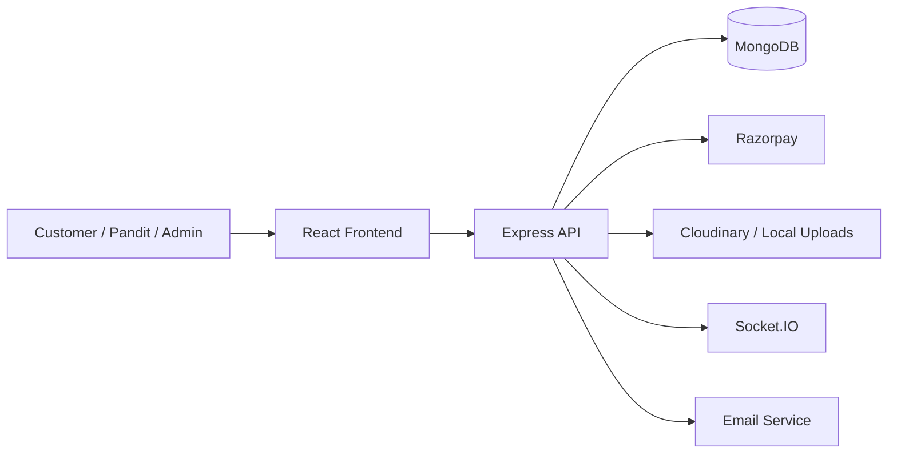

# PanditJi

PanditJi is a full-stack spiritual services platform that connects devotees with verified Pandits for pujas, rituals, bookings, payments, and astrological services such as kundali, horoscope, and compatibility analysis.

This README is written as an interview-ready project brief. You can use it to explain the problem, architecture, tech stack, features, and tradeoffs in a clear way during interviews.

---

## One-Minute Interview Pitch

PanditJi is a web platform for devotees to discover services, book Pandits, make secure online payments, and receive real-time updates. It also supports astrological features like birth chart generation, horoscope predictions, compatibility checking, and free consultation requests. The system has three main roles: customer, Pandit, and admin. I built it with a React frontend, an Express and MongoDB backend, JWT authentication, Razorpay payments, Socket.IO notifications, and image upload support for profile and service management.

---

## What Problem It Solves

Traditional spiritual service booking is usually fragmented. People often depend on phone calls, local references, or manual coordination to find a Pandit, confirm availability, and manage payments. PanditJi centralizes that flow so users can browse services, book trusted Pandits, pay securely, and track everything from one dashboard.

It also gives Pandits and admins their own portals so the platform can scale with structured workflows instead of manual follow-up.

---

## Core Features

### Customer Features

- Register and log in with secure authentication
- Browse spiritual services and Pandits
- Book pujas and related services
- Make secure payments with Razorpay
- View booking history and booking status
- Receive email and real-time notifications
- Request kundali, horoscope, and compatibility analysis
- Send support tickets and manage the account
- Delete account when needed

### Pandit Features

- Log in to a dedicated Pandit dashboard
- View incoming bookings and consultation requests
- Accept, complete, and manage bookings
- Update availability and profile details
- View earnings and performance data
- Manage profile image and personal information
- Handle notifications and verification flow

### Admin Features

- Manage Pandits, services, bookings, and support tickets
- Review dashboard analytics and booking statistics
- Create and update Pandit accounts
- Toggle availability and activity status
- View recent platform activity
- Handle admin booking and customer issues
- Manage consultations and astrological requests

---

## Astrology and Spiritual Service Modules

PanditJi includes several astrology-focused flows beyond basic booking:

- Kundali generation from birth details
- Horoscope lookup by zodiac sign
- Compatibility analysis for two people
- Free astro request flow
- Paid consultation flow
- Marriage yoga and related astrological calculations

These features help the app stand out from a simple booking platform and give the interview more depth when explaining domain complexity.

---

## Tech Stack

### Frontend

- React 19
- Vite
- React Router
- Axios
- Socket.IO client
- React Toastify
- Framer Motion
- Tailwind CSS
- ESLint

### Backend

- Node.js
- Express
- MongoDB with Mongoose
- JWT authentication
- bcryptjs password hashing
- Razorpay payments
- Socket.IO
- Multer for file uploads
- Cloudinary for image storage
- Express Validator
- Helmet and CORS for security

### Deployment

- Backend deployed on Render
- Frontend deployed on Vercel or Netlify depending on environment
- Render config lives in [render.yaml](render.yaml)

---

## Architecture Overview

The app follows a classic client-server architecture.



### Main Flow

1. The frontend collects user input and sends API requests.
2. Express routes validate and authorize the request.
3. Controllers perform business logic.
4. MongoDB stores users, bookings, services, Pandits, and related records.
5. Razorpay handles payments.
6. Socket.IO pushes live updates.
7. Email services send confirmations and account details.

---

## Repository Structure

```text
PanditJi/
├─ Backend/
│  ├─ controllers/       Express request handlers
│  ├─ middleware/        Auth, validation, upload, error handling
│  ├─ models/            MongoDB schemas
│  ├─ routes/            API route definitions
│  ├─ services/          Domain services and integrations
│  ├─ utils/             Email, notification, and helper utilities
│  └─ server.js          Main backend entry point
├─ Frontend/
│  ├─ src/api/           API client wrappers
│  ├─ src/components/    UI components
│  ├─ src/pages/         Screens and pages
│  ├─ src/context/       React context providers
│  └─ src/main.jsx       Frontend entry point
├─ FEATURES.md           Feature catalog
├─ INSTALLATION_GUIDE.md Detailed setup guide
├─ render.yaml           Render deployment config
└─ README.md             Project overview and interview guide
```

---

## Important Backend Routes

The backend is mounted under `/api` in [Backend/server.js](Backend/server.js).

### Authentication

- `POST /api/auth/send-otp`
- `POST /api/auth/verify-otp`
- `POST /api/auth/register`
- `POST /api/user/login`
- `POST /api/user/register`
- `POST /api/pandit/auth/login`

### Services and Pandits

- `GET /api/services`
- `POST /api/services`
- `GET /api/pandits`
- `POST /api/pandits`
- `PUT /api/pandits/:id`

### Bookings and Payments

- `POST /api/bookings`
- `GET /api/bookings`
- `POST /api/payment/create-order`
- `POST /api/payment/verify-payment`

### Admin

- `POST /api/admin/login`
- `GET /api/admin/dashboard`
- `GET /api/admin/all-data`
- `POST /api/admin/pandits`
- `POST /api/admin/services`
- `GET /api/admin/bookings`

### Astrology

- `POST /api/free-astro/kundali`
- `GET /api/free-astro/horoscope/:sign`
- `POST /api/compatibility/compatibility`
- `POST /api/astro-consultation/request`

See the route files in [Backend/routes](Backend/routes) for the full list.

---

## How the App Works

### 1. Customer Journey

The customer signs up, logs in, browses services or Pandits, selects a time slot, makes payment, and receives booking updates through the dashboard, email, and Socket.IO notifications.

### 2. Pandit Journey

The Pandit logs into a separate portal, checks bookings, manages availability, updates profile details, and tracks earnings and reviews.

### 3. Admin Journey

The admin reviews the dashboard, creates or updates Pandit accounts, manages services, monitors bookings, and resolves platform issues.

---

## Setup Instructions

### Prerequisites

- Node.js 18 or higher
- npm
- MongoDB local or Atlas
- Razorpay account for payments
- Cloudinary account for media storage
- Email credentials for notifications

### Backend Setup

1. Go to the backend folder.

```bash
cd Backend
npm install
```

2. Copy [Backend/.env.example](Backend/.env.example) to `Backend/.env` and fill in the values.

3. Start the backend.

```bash
npm run dev
```

### Frontend Setup

1. Go to the frontend folder.

```bash
cd Frontend
npm install
```

2. Create `Frontend/.env` and set your API base URL.

3. Start the frontend.

```bash
npm run dev
```

### Create Admin Account

The backend includes a bootstrap script at [Backend/createAdmin.js](Backend/createAdmin.js). It uses `ADMIN_PASSWORD` from environment variables to create or update the admin account.

```bash
cd Backend
node createAdmin.js
```

---

## Environment Variables

### Backend

- `PORT` — backend port
- `NODE_ENV` — development or production
- `MONGODB_URI` — MongoDB connection string
- `JWT_SECRET` — JWT signing secret
- `RAZORPAY_KEY_ID` — Razorpay key ID
- `RAZORPAY_KEY_SECRET` — Razorpay key secret
- `CLOUDINARY_CLOUD_NAME` — Cloudinary cloud name
- `CLOUDINARY_API_KEY` — Cloudinary API key
- `CLOUDINARY_API_SECRET` — Cloudinary API secret
- `EMAIL_SERVICE` — email provider
- `EMAIL_USER` — email account
- `EMAIL_PASS` — email password or app password
- `ADMIN_EMAIL` — admin email address
- `ADMIN_PASSWORD` — password used by [Backend/createAdmin.js](Backend/createAdmin.js)
- `FRONTEND_URL` — frontend origin used for links and CORS
- `CORS_ORIGINS` — comma-separated list of allowed browser origins

### Frontend

- `VITE_API_BASE_URL` — backend API base URL

Refer to [Backend/.env.example](Backend/.env.example) and [Frontend/.env.example](Frontend/.env.example) for the exact template values.

---

## Key Implementation Notes

- Authentication uses JWT and role-based access control.
- Passwords are hashed with bcrypt before storage.
- Booking and admin flows are protected by middleware.
- File uploads support Pandit and service images.
- Socket.IO is used for live platform updates.
- Razorpay is used for payment order creation and verification.
- Mongoose schemas define the platform entities and validation rules.
- The backend supports both cloud image uploads and local fallback storage.

These are strong points to mention in an interview because they show you handled security, scalability, and operational fallback behavior.

---

## Interview Questions and Sample Answers

### 1. What is PanditJi?

PanditJi is a spiritual services marketplace that allows users to book verified Pandits for pujas and related services, pay online, and use astrology tools like kundali and compatibility analysis.

### 2. Why did you build this project?

I built it to solve the real-world problem of fragmented puja booking and to create a single platform where devotees, Pandits, and admins can interact efficiently.

### 3. What is your tech stack?

The frontend is built with React and Vite, and the backend uses Node.js, Express, MongoDB, Mongoose, JWT, Razorpay, Socket.IO, and Cloudinary.

### 4. How does authentication work?

Users log in with role-based authentication. The backend issues JWT tokens, and middleware checks the token before allowing access to protected routes.

### 5. How are passwords stored?

Passwords are hashed using bcrypt before being saved in MongoDB, so raw passwords are never stored.

### 6. How does the booking flow work?

The user selects a service or Pandit, submits booking details, and the backend stores the booking and updates status through the admin or Pandit workflow.

### 7. How do payments work?

Payment orders are created through Razorpay. After payment, the backend verifies the payment signature before marking the transaction as successful.

### 8. How did you handle image uploads?

The app supports image uploads for Pandits and services. It uses Cloudinary when configured and falls back to local storage when cloud credentials are not available.

### 9. Why did you use Socket.IO?

I used Socket.IO for real-time notifications so that booking and status changes can be reflected immediately without manual refresh.

### 10. What are the main roles in the system?

There are three roles: customer, Pandit, and admin. Each role has a separate dashboard and access level.

### 11. What is the most difficult part of the project?

The hardest part was coordinating multiple flows together, especially authentication, payments, notifications, and admin management while keeping the system maintainable.

### 12. How did you organize the backend?

I used a controller-route-model structure. Routes handle endpoints, controllers contain the business logic, and models define the database schemas.

### 13. Why did you choose MongoDB?

MongoDB fit well because the application has many related but flexible documents such as bookings, services, consult requests, reviews, and notifications.

### 14. How is security handled?

Security is improved through JWT authentication, password hashing, validation middleware, CORS restrictions, Helmet, and role-based access control.

### 15. What can be improved in future?

Future improvements include stronger analytics, better search and filtering, advanced notification channels, mobile app support, and improved admin reporting.

---

## Good Interview Talk Track

If the interviewer asks you to explain the project, you can say:

1. I built a full-stack spiritual service booking platform.
2. Users can register, browse Pandits and services, book pujas, and pay securely.
3. Pandits have a separate portal to manage bookings, availability, and earnings.
4. Admins can manage the entire platform from a dedicated dashboard.
5. I also added astrology modules like kundali, horoscope, and compatibility.
6. The project uses React, Node.js, MongoDB, JWT, Razorpay, Socket.IO, and Cloudinary.
7. My main focus was secure workflows, role-based access, and a smooth user experience.

---

## Deployment

This project is designed for split deployment:

- Backend on Render from [render.yaml](render.yaml)
- Frontend on Vercel or Netlify depending on build configuration

For production, make sure:

- `FRONTEND_URL` matches the deployed frontend origin
- `CORS_ORIGINS` includes all allowed origins
- `MONGODB_URI`, `JWT_SECRET`, `RAZORPAY_*`, and `CLOUDINARY_*` are set in the deployment environment

---

## Future Enhancements

- Mobile app version
- Advanced search and recommendation system
- Better booking analytics for admin and Pandit dashboards
- Live chat between customer and Pandit
- More detailed astrology reports with PDF export
- Push notifications and SMS alerts
- Multi-language support expansion

---

## Related Files

- [FEATURES.md](FEATURES.md) for the full feature catalog
- [INSTALLATION_GUIDE.md](INSTALLATION_GUIDE.md) for step-by-step setup
- [Backend/server.js](Backend/server.js) for API wiring and server bootstrap
- [Backend/routes](Backend/routes) for endpoint details
- [Backend/createAdmin.js](Backend/createAdmin.js) for admin bootstrap logic

---

## Summary

PanditJi is a complete full-stack booking and astrology platform that demonstrates authentication, role-based dashboards, secure payments, real-time updates, file uploads, and modular backend design. For interviews, the strongest points to highlight are the multi-role architecture, secure payment flow, real-time notifications, and the combination of service booking with astrology tools.
